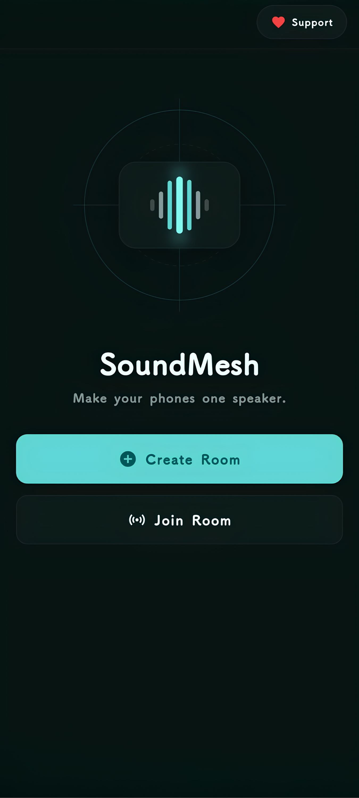
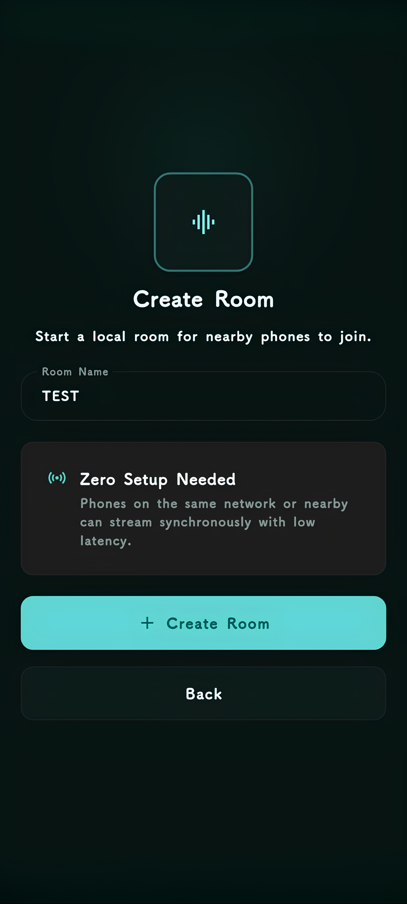
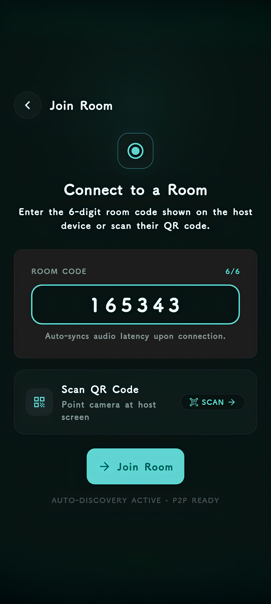
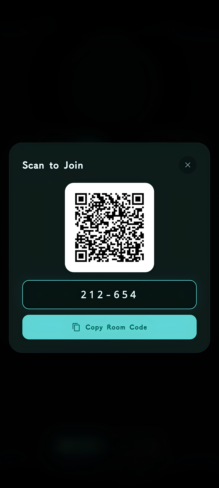
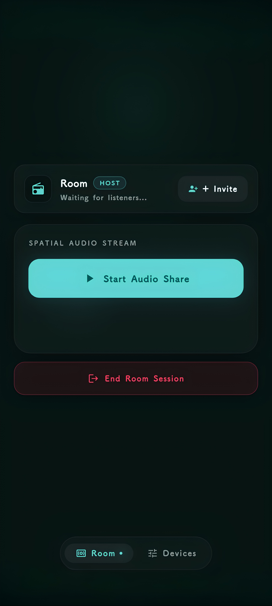
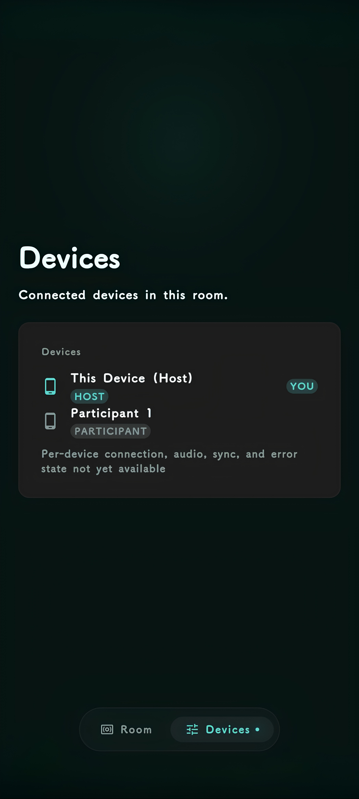
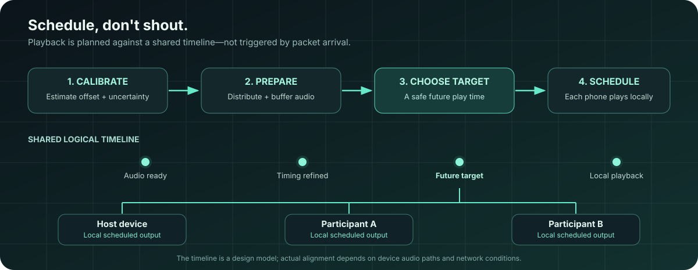
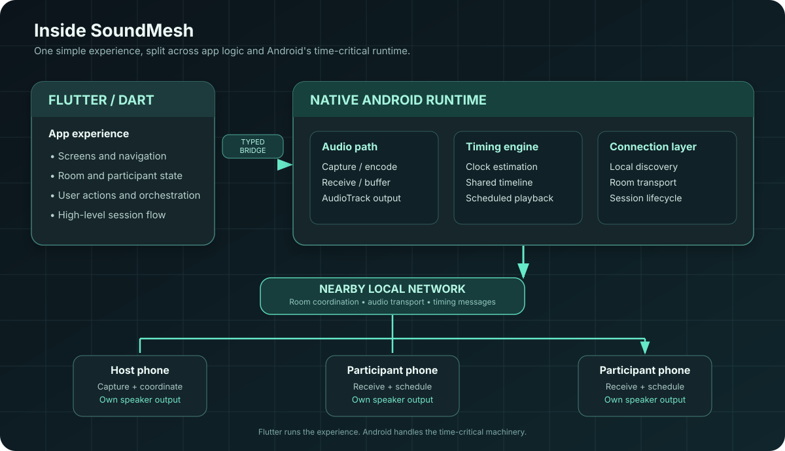

<!-- SoundMesh animated GitHub README header -->
<div align="center">

<table width="100%" bgcolor="#10191B" border="0">
  <tr>
    <td width="17%" align="center" valign="middle">
      
    </td>
    <td width="83%" align="center" valign="middle">
      <a href="https://github.com/farazkayan/SoundMesh">
        
      </a>
    </td>
  </tr>
</table>

<br />


<br />

<p>
  <a href="https://getsoundmesh.pages.dev"><strong>Website</strong></a>
  &nbsp;·&nbsp;
  <a href="https://github.com/farazkayan/SoundMesh/releases"><strong>Releases</strong></a>
  &nbsp;·&nbsp;
  <a href="https://github.com/farazkayan/SoundMesh/issues"><strong>Issues</strong></a>
  &nbsp;·&nbsp;
  <a href="https://github.com/farazkayan/SoundMesh/blob/main/CONTRIBUTING.md"><strong>Contributing</strong></a>
</p>

<p>
  <a href="https://github.com/farazkayan/SoundMesh/stargazers"></a>
  <a href="https://github.com/farazkayan/SoundMesh/network/members"></a>
  <a href="https://github.com/farazkayan/SoundMesh/commits/main"></a>
  <a href="https://github.com/farazkayan/SoundMesh/blob/main/LICENSE"></a>
</p>

<p>
  
  
  
  
</p>

</div>

---

## The idea

You have music. You have a few old phones. You don't have a speaker that fills the room.

**What if the phones could become the speaker?**

SoundMesh lets nearby Android devices join a shared room and contribute their own speakers to one coordinated listening experience. One device hosts, others join, and the app works to coordinate playback across the group.

The experience should feel simple:

<p align="center">
  <strong>CREATE A ROOM</strong> &nbsp; → &nbsp; <strong>JOIN WITH QR</strong> &nbsp; → &nbsp; <strong>PLAY TOGETHER</strong>
</p>

The engineering underneath is anything but simple: every phone has its own clock, network conditions, audio pipeline, buffer, speaker hardware, and Android lifecycle.

> **The goal:** make the user forget that the sound is coming from multiple devices.

## At a glance

<table>
  <tr>
    <td width="50%" valign="top">
      <h3>◉ Room-based listening</h3>
      Create a room on the host and invite nearby phones to join the session.
    </td>
    <td width="50%" valign="top">
      <h3>⌗ QR joining</h3>
      Let participants scan a room QR code instead of typing connection details by hand.
    </td>
  </tr>
  <tr>
    <td width="50%" valign="top">
      <h3>⌁ Timing-aware playback</h3>
      Use clock estimates and a shared logical timeline to schedule playback, rather than treating message arrival as the play command.
    </td>
    <td width="50%" valign="top">
      <h3>⌘ Native Android audio</h3>
      Keep timing-sensitive audio and platform behavior close to Android's native APIs.
    </td>
  </tr>
  <tr>
    <td width="50%" valign="top">
      <h3>⌂ Local-first design</h3>
      The core nearby-device audio session is designed around a local network, not a hosted cloud audio relay.
    </td>
    <td width="50%" valign="top">
      <h3>↻ Room lifecycle & recovery</h3>
      Treat joining, leaving, disconnects, and ending a room as real states to manage—not just sockets to open and forget.
    </td>
  </tr>
</table>

> **Project status:** SoundMesh is shipped. Synchronization quality can still vary with phone models, Android versions, speaker hardware, and network conditions; perfect sample-accurate playback is not guaranteed on every device.

---

## SoundMesh in the real app

The screenshots below are from the project—not mockups. The gallery stays collapsed until you choose to open it.

<details>
<summary><strong>🖼️ Open the screenshot gallery · 6 screens</strong></summary>

<br />

<table>
  <tr>
    <td align="center" width="50%">
      <strong>Home</strong><br /><br />
      <a href="app/assets/images/home_screen.png"></a>
    </td>
    <td align="center" width="50%">
      <strong>Create a room</strong><br /><br />
      <a href="app/assets/images/create_room.png"></a>
    </td>
  </tr>
  <tr>
    <td align="center">
      <strong>Join a room</strong><br /><br />
      <a href="app/assets/images/join_room.png"></a>
    </td>
    <td align="center">
      <strong>Scan to connect</strong><br /><br />
      <a href="app/assets/images/qrcode_modal_popup.png"></a>
    </td>
  </tr>
  <tr>
    <td align="center">
      <strong>Room dashboard</strong><br /><br />
      <a href="app/assets/images/room_dashboard.png"></a>
    </td>
    <td align="center">
      <strong>Connected devices</strong><br /><br />
      <a href="app/assets/images/room_devices_screen.png"></a>
    </td>
  </tr>
</table>

</details>
---

## How it works

At a high level, a session moves through these stages:

1. **Create** — a host creates a room and shares the QR code.
2. **Connect** — participants scan the code and establish a nearby-device connection.
3. **Prepare** — devices exchange session state and get audio ready for playback.
4. **Calibrate** — the timing model estimates relationships between device clocks.
5. **Schedule** — the session selects a future playback target so devices can prepare instead of reacting to packets at different times.
6. **Play and monitor** — each device outputs audio locally while the session manages participant and room lifecycle changes.

<p align="center">
  
</p>

### Why not just send “PLAY NOW”?

A network message will not reach every phone at the exact same instant. If each phone starts when its own message arrives, network delay becomes audible timing difference.

SoundMesh instead works toward a **shared logical timeline**. Devices prepare their audio and schedule playback against a future target. That is a better foundation for coordinated playback, though real-world alignment still depends on each device's audio path and network conditions.

---

## Architecture

SoundMesh separates the everyday app experience from timing-sensitive platform work.

<p align="center">
  
</p>

**Flutter runs the experience. Android handles the time-critical machinery.**

| Layer | Responsibility |
|---|---|
| Flutter / Dart | Screens, navigation, room state, participant experience, user actions, and high-level orchestration |
| Typed native bridge | Communication between Dart application logic and Android platform code |
| Native Android | Audio capture/playback, networking, timing, scheduling, lifecycle and platform integrations |
| Local network | Nearby-device coordination, room messages, and audio transport |
| Device speakers | Each participating phone produces its own local audio output |

### The synchronization model

SoundMesh needs to reason about multiple timing concepts separately:

| Concept | Why it matters |
|---|---|
| Clock offset | Estimates how device timing references differ |
| Round-trip time (RTT) | Measures the time taken by a request/response exchange |
| Jitter | Captures variation in message timing |
| Buffering | Gives a device audio data ready before its playback target |
| Audio latency | Accounts for delay introduced by a device's audio path |
| Drift | Describes timing alignment changing over time |

Low network latency alone does not guarantee synchronized sound. Timing estimates, buffering, native scheduling, and the actual phone hardware all matter.

### Audio path, conceptually

```text
Host audio / capture
        │
        ▼
 Audio frames
        │
        ▼
 Local-network transport
        │
        ▼
 Participant receives & buffers
        │
        ▼
 Shared timeline + playback target
        │
        ▼
 Native Android audio output
        │
        ▼
 Phone speaker
```

This is a conceptual overview of the system. It is not a guarantee that every device or network follows an identical timing path.

---

## Technology

| Area | Technology |
|---|---|
| App framework | Flutter |
| Application language | Dart |
| Platform | Android |
| Native integration | Kotlin / Java and Android platform APIs |
| State management | Riverpod (`flutter_riverpod`) |
| QR generation | `qr_flutter` |
| QR scanning | `mobile_scanner` |
| Local preferences | `shared_preferences` |
| Audio APIs | Android audio capture and `AudioTrack` playback |
| Purchase integration | RevenueCat SDK with Test Store support for development/testing flows |
| Website | Separate project under `site/` |

SoundMesh is intentionally Android-first. The project focuses its effort on the platform capabilities relevant to multi-device audio instead of pretending all platforms have identical audio and lifecycle behavior.

---

## Get started

### Requirements

- Flutter SDK compatible with the project's Dart constraint (`>=3.12.0 <4.0.0`)
- Android SDK and Android build tools
- Android Studio or equivalent Android tooling
- An Android device or emulator
- For actual multi-phone testing, two or more Android phones on the same reachable local network

### 1. Clone the repository

```bash
git clone https://github.com/farazkayan/SoundMesh.git
cd SoundMesh/app
```

### 2. Install dependencies

```bash
flutter pub get
```

### 3. Connect a device and run

```bash
flutter devices
flutter run
```

For a basic UI check, an emulator may help. For meaningful timing and audio validation, test on **real Android phones**.

### Build a release APK

```bash
flutter build apk --release
```

The APK is generated at:

```text
build/app/outputs/flutter-apk/app-release.apk
```

Install it on a connected device with:

```bash
adb install -r build/app/outputs/flutter-apk/app-release.apk
```

Check connected Android devices with `adb devices`. If more than one device is attached, use `adb -s DEVICE_SERIAL install -r build/app/outputs/flutter-apk/app-release.apk` to target a specific phone.

---

## Test it properly

A multi-device audio app cannot be validated by a successful build alone.

1. Install the same build on at least two physical Android phones.
2. Put the phones on the same local network and confirm the devices can reach each other.
3. Create a room on the host phone.
4. Join from a participant phone using the QR flow.
5. Test normal playback, joining and leaving, ending the room, and creating a new room afterward.
6. Repeat with different device combinations and network conditions; listen for timing differences, dropouts, and recovery behavior.

### Useful development checks

Run these from the `app/` directory:

```bash
flutter analyze
flutter test
flutter build apk --release
```

Automated tests catch many regressions, but they cannot prove real-world synchronization across every Android device. Physical testing remains essential.

---

## Shipped status & known limitations

SoundMesh has shipped with room creation and joining, QR-based joining, multi-participant sessions, audio capture/transport, synchronization-related timing logic, scheduled playback paths, room lifecycle handling, recovery flows, and the Android-focused app experience. As with any multi-device audio system, real-world results vary between devices and network conditions.

Real results vary with:

- Android version and manufacturer-specific behavior
- Audio hardware and device-specific latency
- CPU load, thermal state, and background execution limits
- Local-network quality, jitter, and packet loss
- Audio buffering and the device's native playback pipeline
- Permission and lifecycle behavior during a session

**SoundMesh is shipped software.** Report reproducible bugs with device model, Android version, network setup, and steps to reproduce. Synchronization is designed to coordinate playback, but two unrelated phones may not remain perfectly aligned in every environment.

---

## Repository layout

```text
SoundMesh/
├── .github/                 # GitHub workflows and repository automation
├── app/                     # Flutter app and native Android implementation
│   └── assets/images/       # App screenshots and image assets
├── assets/readme/            # README hero animation and architecture diagrams
├── site/                    # SoundMesh website
├── CONTRIBUTING.md           # Contribution guide
├── LICENSE                  # MIT license
└── README.md                # Project overview
```

---

## Contributing

Bug reports, thoughtful issues, and focused pull requests are welcome.

- Search existing issues before opening a duplicate.
- Include steps to reproduce and relevant device/network details for bugs.
- Keep changes focused; avoid unrelated rewrites of timing-sensitive code.
- Run `flutter analyze` and relevant tests before submitting.
- Document changes that affect room behavior, audio timing, permissions, or recovery.

Read the [contribution guide](CONTRIBUTING.md) before opening a pull request.

## Team

<p align="center">
  <a href="https://github.com/farazkayan"><strong>Faraz Kayan</strong></a>
  &nbsp; · &nbsp;
  <a href="https://github.com/mahinite"><strong>Mahinite</strong></a>
  <br>
  Built together around one question: what if the speaker could be the phones you already own?
</p>

## License

SoundMesh is released under the [MIT License](LICENSE).

<p align="center">
  
  <br>
  <strong>SoundMesh</strong>
  <br>
  <sub>Multiple phones. One sound.</sub>
</p>
